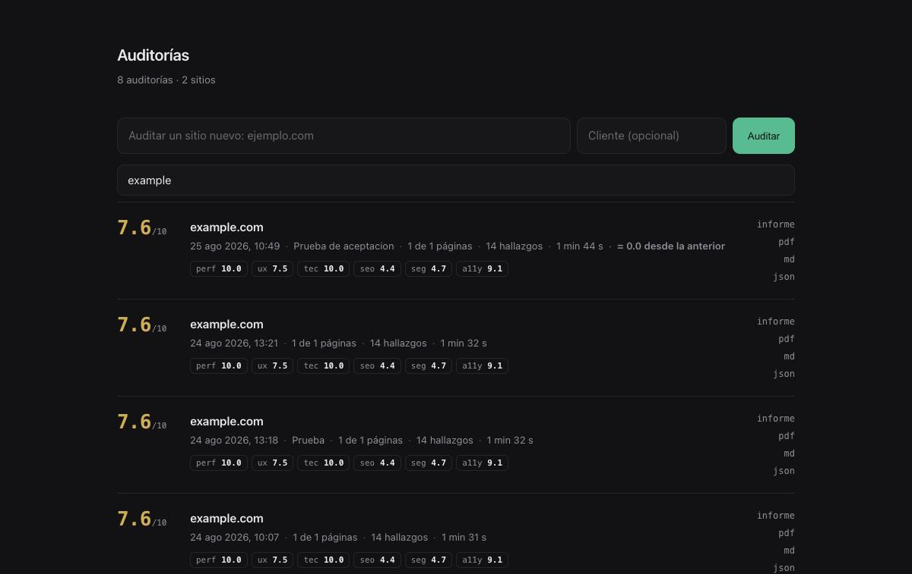
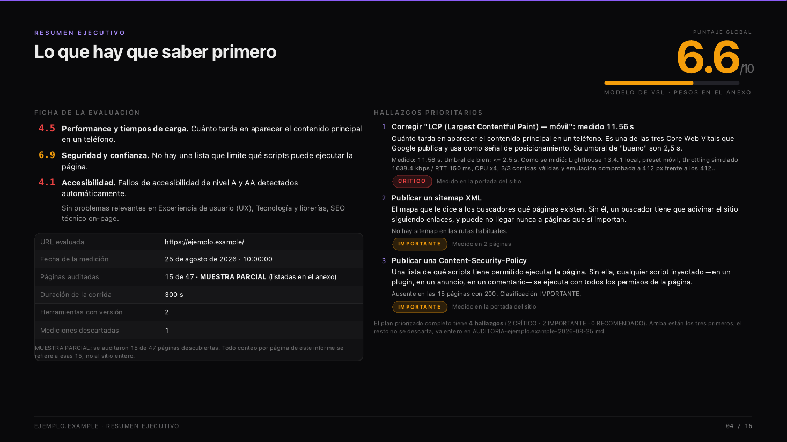

# Audit Showcase

A website auditing system that **refuses to report anything it did not measure**.

It queues technical audits, runs them one at a time, and produces a client-ready report
where every single number carries its source file, its timestamp and the tool version that
produced it — and where anything that could not be measured says so, with the reason,
instead of being quietly filled in.

Python standard library. No framework, no `npm install`, no database, no dependencies.

> Code and documentation are in Spanish — it is an internal tool for a Spanish-speaking
> team. This README is in English; the [glossary](#glossary) maps the terms you will meet
> in the code.



*Type a site, it gets queued, and the card shows which of the six steps it is on. The delta
against the previous run of the same site appears next to it — that is what turns a one-off
diagnosis into monitoring.*



*The report's executive summary. The verdict names each weak axis in plain language; the
forensic detail sits underneath, smaller. The cover states **partial sample · 15 of 47
pages** because that is what was measured.*

*(Both images use `example.com` and a synthetic fixture — no client data.)*

---

## The problem it was built to solve

An agency audited a client's WordPress site and reported the security headers as present.
They were not. The site had page caching: a **404 executes PHP and emits the headers**,
while the real page is served from cache as a static file and emits none. Measuring on an
error page shows green on exactly the URLs no visitor ever requests.

We made the same mistake twice before noticing.

So it is not a guideline here, it is a hard rule enforced in code: **any response that is
not a 200 is dropped into `medicion_invalida[]` with its reason and counts toward no
indicator.** The failure is reproduced as a permanent test case — a local server that emits
security headers on the 404 and none on the 200 — so the trap cannot come back.

That is the whole design philosophy in one story. Everything else follows from it:

- If a score cannot be computed, the report prints `NO MEASURED` and the reason, never a zero.
- If 15 of 47 pages were audited, the cover says **partial sample** and every per-page count
  states it again.
- Effort estimates are impossible from outside, so `hallazgo()` **throws** if anyone passes a
  number instead of `NO_MEDIDO`. Measured scope (`urls_afectadas`) is published instead.
- Discarded measurements are listed in the annex. A measurement dropped in silence is
  indistinguishable from one that succeeded.

## What it measures

Six axes in a single report, using free software and public APIs — no LLM anywhere in the
pipeline:

| Axis | Tools (versions read at runtime, not declared) |
|---|---|
| Performance | Lighthouse · Chrome DevTools Protocol · PageSpeed Insights field data (CrUX) |
| UX | Rendered DOM via Chrome, verified mobile emulation, `aspell` |
| Technology | Fingerprints over raw HTML and rendered DOM · `api.wordpress.org` · `endoflife.date` |
| SEO | Own parser over both raw HTML and rendered DOM — the two are different numbers |
| Security | SSL Labs API · headers read over 200s only · own TLS handshake via `node:tls` |
| Accessibility | `axe-core` · WebAIM's WAVE taxonomy |

Both lab and field data for performance: Lighthouse from the machine, and CrUX — how the site
actually behaved for real Chrome users. When the two agree, the number is solid. When they
disagree, that is information too.

## Engineering decisions worth explaining

**The queue is serial, and not out of tidiness.** The performance axis runs Chrome alone: if
it shares CPU with another browser, its timings stop measuring the site and start measuring
the machine. Two concurrent audits would not be slower — they would be **wrong**.

**Cancelling kills the process group, not the child.** The audit script traps `SIGTERM`
without exiting, and its axes run as background subshells that inherit `stdout`. Signalling
only the direct child left the pipe open and the worker blocked for the full duration of the
audit. `start_new_session=True` plus `killpg` fixed it — and the regression test uses a
stub that reproduces exactly that shape, because the naive test passes either way.

**Fresh browser profile per run.** Profiles used to persist and accumulated cached HTTP
responses, cookies and history. If Chrome serves a response from its own cache, the headers
observed are the cached ones — a back door straight through the 200-only rule.

**Launching is gated; reading is not.** Reading is open by choice. Launching is not: a public
button that runs a scanner against any URL, from this IP, is a gift to whoever finds the
address. Two barriers, both needed — tunnel traffic is rejected by its `CF-*` headers, and
same-origin proof is required, because a hidden form on any site the operator visits would
otherwise POST from their own browser and look local.

**`Referrer-Policy` must be `same-origin`.** With `no-referrer` the browser sends
`Origin: null` and suppresses `Referer`, so the CSRF check has nothing to inspect and the app
rejects its own forms. Two individually correct security measures that break the application
together. There is a test guarding it.

**Client audits never reach the internet.** Two roots: one public, one private, and the
default is private. Filtering the listing was not enough — anyone knowing an id could still
request it — so `por_id()` honours the same flag and a private audit simply *does not exist*
for a tunnel visitor.

## How it is verified

**176 tests, standard library only.** In a clean clone, 109 of them run. The other 67
exercise the measurement engine, which lives in a private repository (see
[Scope](#scope-of-this-repository)); they skip with a stated reason unless
`SITE_AUDIT_ENGINE` points at it. They are not replaced with a stub on purpose: a stub
would make the count look complete while testing nothing real.

```bash
python3 -m unittest discover -s tests -t .
# Ran 176 tests ... OK (skipped=67)
```

The ones that matter are not the happy path:

- `test_traversal_con_socket_crudo_no_filtra` speaks HTTP by hand, because `urlopen`
  normalises `..` before sending: the "normal" traversal test passes even against a sieve.
- `TestCancelarCorriendo` cancels a job that is genuinely running, using a double that traps
  `TERM` without dying and leaves a child holding `stdout`.
- `TestInvariantesDetectan` breaks data on purpose. An invariant that never fails is decoration.
- The report harness asserts **properties, not bytes** — a frozen HTML file would break on
  every run over timestamps and paths, and a test that always fails gets ignored.

**A calibration campaign** ran the engine against 15 targets × 2 runs. 30/30 completed, zero
invariants broken, and the independent oracles (`curl` for headers, `openssl` for TLS, a
separately written sitemap parser) agreed exactly with the engine.

The campaign also includes **seven hostile cases served on localhost**: a permanent 500,
redirect chains, invalid HTML, Latin-1, slow responses, a missing sitemap, and the
headers-only-on-404 reproduction.

Telling an independent oracle from a circular one is the heart of that design: `curl` does not
go through Chrome, so it validates for real. Comparing against Lighthouse's own JSON validates
the *extraction*, not the measurement, and calling that cross-validation would be a lie.

**What is honestly not covered:** crawl scale. It samples pages rather than crawling entire
sites, so it is not a replacement for a dedicated crawler on a large e-commerce.

## Running it

```bash
RAICES=~/audits python3 servidor.py 8096
```

| Variable | Purpose |
|---|---|
| `RAICES` / `RAICES_PRIVADAS` | Where to look for audits; the private ones never reach the internet |
| `CASA` / `CASA_PUBLICA` | Where new audits land, chosen by request origin |
| `AUTH_FILE` | `user:password`. Without it the showcase is **open** and says so on stderr |
| `PSI_KEY_FILE` | Path to the PageSpeed key. The key itself never goes in the plist |
| `CUOTA_POR_HORA` | Cap on audits launched from the internet |
| `SITE_AUDIT_ENGINE` | Folder of the measurement engine. Without it, the queue cannot launch audits and the engine tests skip |

In production it runs under `launchd`; `infra/launchd.example.plist` is the template, with
every path left as `/path/to/...`. **Restart with `infra/reiniciar-seguro.sh`, never with
`launchctl kickstart`** — kickstart restarts the process but reuses the *already loaded*
configuration, so plist changes silently do not apply. The script also refuses to restart
unless it can prove the queue is idle; it fails closed, because a timed-out `curl` is most
likely exactly when an audit is running.

```
servidor.py              entry point
vitrina/almacen.py       what counts as an audit, and which paths may be served
vitrina/indice.py        results -> listing card, and the delta against the previous run
vitrina/cola.py          serial queue, progress, cancellation, history
vitrina/web.py           auth, routing, delivery
calibracion/             corpus, oracles and verdict
```

## Scope of this repository

This repo is the **front end and the verification harness**. The measurement engine itself
(about 16,000 lines across six axis modules and the report generator) lives in a private repository,
since its rubric encodes client-specific calibration work.

What is here and reviewable: the serial queue and its process handling, the security model,
the calibration harness with its oracles, and the regression suite that keeps the report
honest.

## Glossary

| In the code | Meaning |
|---|---|
| `vitrina` | The showcase: the web front end that lists audits and queues new ones |
| `cola` | The serial audit queue |
| `almacen` | The store: what counts as an audit on disk, and which paths may be served |
| `eje1` … `eje6` | The six axes: performance, UX, technology, SEO, security, accessibility |
| `indicador` / `hallazgo` | A measured indicator / a finding reported to the client |
| `NO_MEDIDO` | Not measured. Printed with its reason, never turned into a zero |
| `medicion_invalida` | A measurement discarded because the response was not a 200 |
| `muestra_parcial` | Partial sample: fewer pages audited than discovered |
| `calibracion`, `oraculos`, `veredicto` | Calibration campaign, independent oracles, and the pass/fail verdict |
| `RAICES` / `CASA` | Folders to index / folder where new audits land |

## Principle

Every number in the report can be traced to a file, an hour and a tool version. Anything
that could not be measured says so and explains why. Nothing is ever translated into money —
nobody measured that.

What gets hidden is what nobody fixes.
